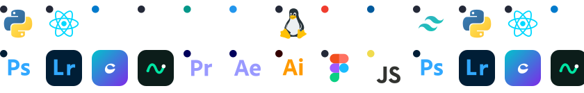

  <!-- 👑 OFFICIAL YASHWANTHHDEV BANNER (Used once at the top) -->
  

    

  <!-- 🌟 GREETING & MANIFESTO -->
  <h1>Hi, I'm Yashwanth H B</h1>

  

    <em>ECE student at Maharaja Institute of Technology, Mysore • 4x Hackathon Podium Finisher</em>
  

   

  <!-- Minimalist Connect Badges -->
  

    
    &nbsp;
    
    &nbsp;
    
    &nbsp;
    
  

<!-- ==================== ABOUT ME ==================== -->
### About Me

<table>
  <tr>
    <td width="65%" valign="top">
      <h3>Hi, I'm Yashwanth H B</h3>
      

        ECE student at Maharaja Institute of Technology, Mysore. I enjoy building things, exploring new technologies, and learning by doing. Interested in cybersecurity, software development, cloud computing, and digital design.
      

      

        4x Hackathon podium finisher. Always experimenting with ideas, learning new tools, and turning what I learn into real projects.
      

      

        <strong>Interests:</strong> Cybersecurity, Python, full-stack development, networking, cloud computing, and digital design.
      

       
      
<strong>Connect with me:</strong>

      <ul>
        <li>Email: <a href="mailto:yashuhb18@gmail.com">yashuhb18@gmail.com</a></li>
        <li>LinkedIn: <a href="https://www.linkedin.com/in/yashwanthhb" target="_blank">linkedin.com/in/yashwanthhb</a></li>
        <li>GitHub: <a href="https://github.com/yashwanthhdev" target="_blank">github.com/yashwanthhdev</a></li>
        <li>Portfolio: <a href="https://portfolio-yashz.vercel.app/" target="_blank">My website</a></li>
      </ul>
    </td>
    <td width="35%" align="center" valign="middle">
      
    </td>
  </tr>
</table>

<!-- ==================== 🏆 HACKATHON VICTORIES ==================== -->
### 🏆 Hackathon Victories &amp; Recognition

* 🥇 **JanDarpan** — **1st Prize (National Level)**
  > *Dhanalakshmi Srinivasan College of Engineering, Tamil Nadu*
  > Citizen Governance &amp; AI Forensic Audit Engine auditing **4,290+ government schemes** in real-time with GLM-4 &amp; Polygon blockchain ledger.
  > `GLM-4 AI` • `Polygon Web3` • `React` • `Node.js` • `FastAPI`

* 🥇 **RoomiFY** — **1st Prize (Inter-College)**
  > *Ethnotech Academy*
  > Smart roommate discovery and verified accommodation platform featuring multi-factor behavioral compatibility scoring.
  > `TypeScript` • `React` • `TailwindCSS` • `Node.js`

* 🥉 **CyberTwin** — **2nd Runner Up (State Level)**
  > *CIT Engineering College, Mandya*
  > AI-Powered Application Security Digital Twin constructing real-time dynamic knowledge graphs of vulnerability paths before deployment.
  > `TypeScript` • `TanStack Start` • `FastAPI` • `Knowledge Graph`

* 🎯 **PHANTOM** — **Shortlisted (National Level)**
  > *DY Patil College of Engineering, Maharashtra*
  > Autonomous Hardware Threat Hunting &amp; Deception Platform mapped to the MITRE ATT&amp;CK matrix with decoy telemetry.
  > `Python` • `FastAPI` • `React` • `MITRE ATT&CK`

<!-- ==================== 🎮 COMMIT ARCADE ==================== -->
### 🎮 The Commit Telemetry &amp; Live Arcade

  
<em>Real-time commit telemetry across 52 weeks with animated Spider-Man crawler — click below to enter the live streaming portal:</em>

  

    

  
  &nbsp;
  

<!-- ==================== ⚔️ FLAGSHIP PROJECTS ==================== -->
### ⚔️ Flagship Projects &amp; Deployed Systems

* **[PHANTOOM](https://github.com/yashuhb18/PHANTOOM)** — `Autonomous Hardware Threat Hunting & Deception Platform`
  > Real-time telemetry extraction, hardware canary decoys & automated MITRE ATT&CK adversary evasion analysis.
  > `Python` • `FastAPI` • `React` • `Hardware Security`

* **[CyberTwin](https://github.com/yashuhb18/CyberTwin)** — `AI-Powered AppSec Digital Twin & Knowledge Graph`
  > Generates structural digital twins of live web services to trace and neutralize multi-step exploit chains.
  > `TypeScript` • `TanStack Start` • `FastAPI` • `Security Graphs`

* **[JanDarpan-Breaking-Bad](https://github.com/yashuhb18/JanDarpan-Breaking-Bad)** — `Citizen Governance & AI Forensic Audit Engine`
  > Dissects public welfare data across 4,290+ government programs with cryptographic proof-of-audit.
  > `GLM-4 AI` • `Polygon Blockchain` • `Node.js` • `React`

* **[RoomiFY](https://github.com/yashuhb18/RoomiFY)** — `Smart Roommate & Accommodation Intelligence`
  > Intelligent preference matching engine for university students with secure verification.
  > `TypeScript` • `React` • `TailwindCSS` • `REST APIs`

* **[Haxrl8](https://haxrl8.vercel.app)** `● LIVE PORTAL` — `National Level Hackathon Management Platform`
  > High-concurrency registration and submission management portal serving live events.
  > `React` • `Vercel` • `Full Stack` • [🌐 Visit haxrl8.vercel.app ↗](https://haxrl8.vercel.app)

* **[MediLink](https://medi-link-six-snowy.vercel.app)** `● LIVE PORTAL` — `Decentralized Healthcare Connectivity Ecosystem`
  > Secure consultations, patient record exchange, and live clinical coordination.
  > `JavaScript` • `React` • `Cloud APIs` • [🌐 Visit medi-link-six-snowy.vercel.app ↗](https://medi-link-six-snowy.vercel.app)

<!-- ==================== LANGUAGES & TOOLS ==================== -->
### Languages &amp; tools I Have placed My Hands On

  

<!-- ==================== SUPPORT ME & FOOTER ==================== -->

  <h3>Support Me 🔥</h3>

  

    

  

    <em>"It's not who I am underneath, but what I build that defines me."</em> ⚡
  

  

    ⚡ Designed &amp; Engineered by <strong>Yashwanth H B</strong> • Mysore, Karnataka, India 🇮🇳
  

