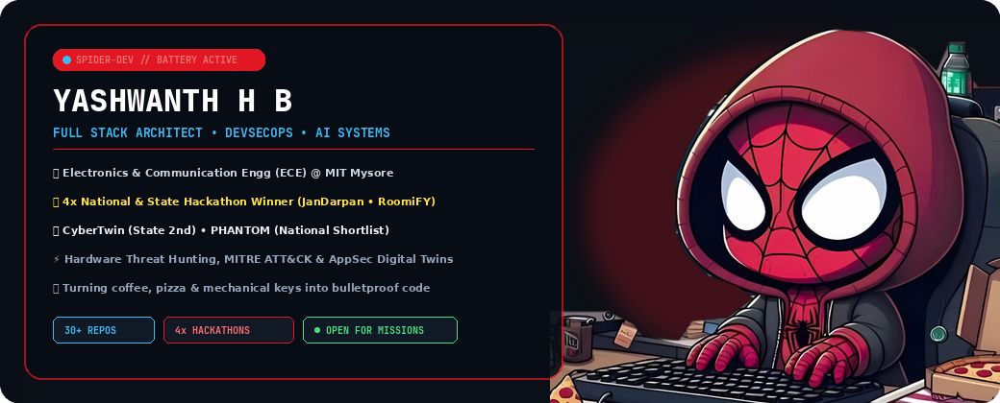
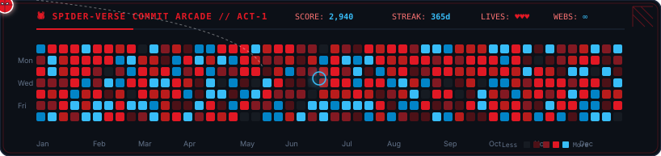

  <!-- 🕷️ HERO BANNER (Matches Joshua Thadi's widescreen top banner) -->
  

    

  <!-- 🌟 GREETING HEADER (Exact Joshua Thadi style) -->
  <h1>Namaste 🙏 I'm Yashwanth H B</h1>

  

    🌟 Full Stack Architect &amp; DevSecOps operative focusing on distributed systems, AI audit engines, and hardware threat deception. Pursuing Electronics &amp; Communication Engineering (ECE) at Maharaja Institute of Technology, Mysore. Built to engineer unstoppable software ⚡.
  

<!-- ==================== 💫 ABOUT ME (Exact Joshua Thadi 2-Column with Desk Coder) ==================== -->
### 💫 About Me

<table>
  <tr>
    <td width="60%" valign="top">
       
      
⏳ I am currently architecting scalable full-stack applications &amp; autonomous threat deception platforms.

      
🏆 <strong>4x Hackathon Champion &amp; Finalist</strong> — engineered winning platforms in 24–36 hour sprints (JanDarpan, RoomiFY, CyberTwin, PHANTOM).

      
💬 Ask me about React, Next.js, FastAPI, Python, TypeScript, Docker &amp; DevSecOps Pipelines.

      
⚡ Interest in Hardware Threat Hunting, MITRE ATT&amp;CK Matrix, AI Digital Twins &amp; Polygon Web3.

      
✨ I only like perfection.

       
      
<strong>🌟 Reach Me on:</strong>

      

        
        &nbsp;
        
        &nbsp;
        
      

    </td>
    <td width="40%" align="center" valign="middle">
      <!-- Coder Spider-Man at Desk (Transparent background matches both Light and Dark theme!) -->
      
    </td>
  </tr>
</table>

<!-- ==================== 🏆 HACKATHON VICTORIES ==================== -->
### 🏆 Hackathon Victories &amp; Recognition

* 🥇 **JanDarpan** — **1st Prize (National Level)**
  > *Dhanalakshmi Srinivasan College of Engineering, Tamil Nadu*
  > Citizen Governance &amp; AI Forensic Audit Engine auditing **4,290+ government schemes** in real-time with GLM-4 &amp; Polygon blockchain ledger.
  > `GLM-4 AI` • `Polygon Web3` • `React` • `Node.js`

* 🥇 **RoomiFY** — **1st Prize (Inter-College)**
  > *Ethnotech Academy*
  > Smart roommate discovery and verified accommodation platform featuring multi-factor behavioral compatibility scoring.
  > `TypeScript` • `React` • `TailwindCSS` • `Node.js`

* 🥉 **CyberTwin** — **2nd Runner Up (State Level)**
  > *CIT Engineering College, Mandya*
  > AI-Powered Application Security Digital Twin constructing real-time dynamic knowledge graphs of vulnerability paths before deployment.
  > `TypeScript` • `TanStack Start` • `FastAPI` • `Knowledge Graph`

* 🎯 **PHANTOM** — **Shortlisted (National Level)**
  > *DY Patil College of Engineering, Maharashtra*
  > Autonomous Hardware Threat Hunting &amp; Deception Platform mapped to the MITRE ATT&amp;CK matrix with decoy telemetry.
  > `Python` • `FastAPI` • `React` • `MITRE ATT&CK`

<!-- ==================== 🎮 SPIDER-MAN COMMIT ARCADE GAME ==================== -->
### 🎮 The Spider-Verse Commit Arcade

  
<em>Spider-Man patrolling the 52-week contribution skyline — click below to enter the live arcade game with real-time 1-commit/sec stream:</em>

  

    

  
  &nbsp;
  

<!-- ==================== ⚔️ FLAGSHIP PROJECTS ==================== -->
### ⚔️ Flagship Projects &amp; Deployed Systems

* **[PHANTOOM](https://github.com/yashuhb18/PHANTOOM)** — `Autonomous Hardware Threat Hunting & Deception Platform`
  > Real-time telemetry extraction, hardware canary decoys & automated MITRE ATT&CK adversary evasion analysis.
  > `Python` • `FastAPI` • `React` • `Hardware Security`

* **[CyberTwin](https://github.com/yashuhb18/CyberTwin)** — `AI-Powered AppSec Digital Twin & Knowledge Graph`
  > Generates structural digital twins of live web services to trace and neutralize multi-step exploit chains.
  > `TypeScript` • `TanStack Start` • `FastAPI` • `Security Graphs`

* **[JanDarpan-Breaking-Bad](https://github.com/yashuhb18/JanDarpan-Breaking-Bad)** — `Citizen Governance & AI Forensic Audit Engine`
  > Dissects public welfare data across 4,290+ government programs with cryptographic proof-of-audit.
  > `GLM-4 AI` • `Polygon Blockchain` • `Node.js` • `React`

* **[RoomiFY](https://github.com/yashuhb18/RoomiFY)** — `Smart Roommate & Accommodation Intelligence`
  > Intelligent preference matching engine for university students with secure verification.
  > `TypeScript` • `React` • `TailwindCSS` • `REST APIs`

* **[Haxrl8](https://haxrl8.vercel.app)** `● LIVE PORTAL` — `National Level Hackathon Management Platform`
  > High-concurrency registration and submission management portal serving live events.
  > `React` • `Vercel` • `Full Stack` • [🌐 Visit haxrl8.vercel.app ↗](https://haxrl8.vercel.app)

* **[MediLink](https://medi-link-six-snowy.vercel.app)** `● LIVE PORTAL` — `Decentralized Healthcare Connectivity Ecosystem`
  > Secure consultations, patient record exchange, and live clinical coordination.
  > `JavaScript` • `React` • `Cloud APIs` • [🌐 Visit medi-link-six-snowy.vercel.app ↗](https://medi-link-six-snowy.vercel.app)

<!-- ==================== 🗂️ LANGUAGES & TOOLS (Exact Joshua Thadi Icon Grid) ==================== -->
### 🗂️ Languages &amp; tools I Have placed My Hands On

  

<!-- ==================== 💻 TECH STACK BADGES (Exact Joshua Thadi Style) ==================== -->
### 💻 Tech Stack:

  
  
  
  
  
  
  

   

  
  
  
  
  
  

<!-- ==================== SUPPORT ME (Exact Joshua Thadi Style) ==================== -->

  <h3>Support Me 🔥</h3>

  

    

  <!-- Panoramic Footer Scene (Transparent background blends into Light and Dark theme!) -->
  

   

  

    <em>"Friendly neighborhood developer building secure, unstoppable software."</em> 🕷️
  

  

    ⚡ Designed &amp; Engineered by <strong>Yashwanth H B</strong> • Mysore, Karnataka, India 🇮🇳
  

